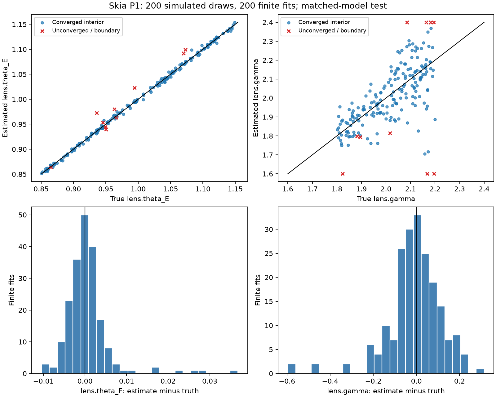

# P1 simulated smooth-model report

Protocol v1; 200 recovery draws. FULL 200+ LENS RUN.

Matched-model synthetic data only. No Q1 cutouts, scientific validation, subhalo detection or cross-platform claims.

## Reproduction

`JAX_PLATFORMS=cpu .venv/bin/python tests/bench/recovery.py --count 200 --bench-count 5 --output docs`

The command above describes the original run. For a repeat, choose a fresh output
folder (for example `make recovery RECOVERY_OUTPUT=work/p1-repeat`); existing raw
results are intentionally protected from overwrite.

Protocol and population ranges are in P1_PROTOCOL.md; exact configuration/environment are in P1_protocol.json.
Raw per-draw truth, estimates, optimizer attempts and failures: P1_recovery.jsonl. Summary with RMSE/error percentiles: P1_summary.json.
The generator supplies an ideal expected-count noise map. All 15 parameters are fitted with two fixed starts; no lens is discarded or retuned.

## Outcomes (all attempted draws)

| Outcome | Count | Rate |
|---|---:|---:|
| Finite results | 200/200 | 100.00% |
| Hard numerical failures | 0/200 | 0.00% |
| Optimization failures (including hard failures) | 0/200 | 0.00% |
| Fits touching a bound | 10/200 | 5.00% |
| Gross recovery failures | 33/200 | 16.50% |

Optimization failure means the selected best result is unconverged or no finite fit is returned.
Bound contacts are counted separately. Gross recovery failure means |theta_E error| > 0.03 arcsec
or |gamma error| > 0.15, or a hard numerical failure. These are predeclared diagnostic thresholds, not statistical significances.
Of the 200 draws, 32 exceed the gamma threshold and one exceeds the theta_E
threshold (33 distinct flagged lenses). Those cases are retained in both the
raw results and all-finite statistics.

## All finite returned fits (including convergence/bound failures)

Denominator: 200/200 draws. Errors are estimate minus truth. Scatter is population std (ddof=0).

| Parameter | Bias | Scatter | RMSE |
|---|---:|---:|---:|
| lens.theta_E | 0.0006400937 | 0.005440111 | 0.005477639 |
| lens.gamma | -0.008414951 | 0.1243585 | 0.1246429 |
| lens.e1 | -0.007744402 | 0.05076554 | 0.05135286 |
| lens.e2 | 0.00460256 | 0.05003687 | 0.0502481 |
| lens.center_x | -0.005695087 | 0.0297342 | 0.03027469 |
| lens.center_y | -0.003183272 | 0.02255349 | 0.02277703 |
| lens.gamma1 | -0.003871058 | 0.02215469 | 0.02249034 |
| lens.gamma2 | 0.001431395 | 0.02056109 | 0.02061085 |
| source.amp | -0.08039312 | 0.8849947 | 0.8886387 |
| source.R_sersic | -0.0001540837 | 0.02057804 | 0.02057862 |
| source.n_sersic | 0.02405502 | 0.1390812 | 0.1411461 |
| source.e1 | 0.002278008 | 0.02521816 | 0.02532084 |
| source.e2 | -0.002227439 | 0.03141619 | 0.03149505 |
| source.center_x | -8.487397e-05 | 0.009222312 | 0.009222703 |
| source.center_y | 0.00167269 | 0.007678821 | 0.007858892 |

Angles/radii are arcsec; source amplitude is e-/s/arcsec²; remaining parameters dimensionless.

## Converged fits with no bound contacts

Denominator: 190/200 draws. Errors are estimate minus truth. Scatter is population std (ddof=0).

| Parameter | Bias | Scatter | RMSE |
|---|---:|---:|---:|
| lens.theta_E | 4.281068e-05 | 0.003363778 | 0.003364051 |
| lens.gamma | -0.004651003 | 0.1044831 | 0.1045866 |
| lens.e1 | -0.001782987 | 0.02110165 | 0.02117684 |
| lens.e2 | 0.0006376406 | 0.02935867 | 0.0293656 |
| lens.center_x | -0.001698866 | 0.01565925 | 0.01575113 |
| lens.center_y | -0.0004144077 | 0.01325557 | 0.01326204 |
| lens.gamma1 | -0.0006842036 | 0.01031839 | 0.01034105 |
| lens.gamma2 | -0.000135629 | 0.01249614 | 0.01249688 |
| source.amp | -0.01466336 | 0.7582676 | 0.7584093 |
| source.R_sersic | -0.0001393422 | 0.01810645 | 0.01810698 |
| source.n_sersic | 0.01224025 | 0.1052395 | 0.1059489 |
| source.e1 | 6.168576e-05 | 0.01961151 | 0.01961161 |
| source.e2 | 0.0002839609 | 0.02133735 | 0.02133924 |
| source.center_x | 0.0004984145 | 0.007644124 | 0.007660356 |
| source.center_y | 0.001993548 | 0.007129942 | 0.007403398 |

Angles/radii are arcsec; source amplitude is e-/s/arcsec²; remaining parameters dimensionless.

## Fit quality and timing

Median chi2/dof among all finite fits: 0.9991666284304224.
40 x 40 fit wall time median: 0.28718710399698466 s; p95: 0.8794009600911501 s.
The first fit of each shape includes JAX compilation; time excludes imports, simulation and file I/O.
Some 40 x 40 recovery timings overlap local test verification, so these are
shared-machine wall times rather than controlled throughput measurements. The
100 x 100 timing sample ran after the test suite completed.
Wall time covers all optimizer starts. Numerical-library thread settings are recorded; JAX CPU execution is not certified single-core.

| 100 x 100 timing sample | Converged | Fit wall time (s) |
|---|---|---:|
| 0 | True | 1.526875542011112 |
| 1 | True | 0.9605114169535227 |
| 2 | True | 0.8227382499608211 |
| 3 | True | 0.755060208030045 |
| 4 | True | 1.0783946249866858 |

100 x 100 subsequent-fit median (4 samples): 0.8916248334571719 s.

## Interpretation and remaining work

The all-finite theta_E bias/scatter are +0.0006401 / 0.0054401 arcsec;
the gamma bias/scatter are -0.008415 / 0.12436. Despite all 200 optimizations
converging and median chi2/dof near one, 16.5% cross the declared accuracy
thresholds. This prototype does not yet demonstrate uniformly reliable mass-slope
recovery, even under a matched source family and known PSF/noise.

These errors characterize only the declared small, relatively simple simulated population and search box.
The mass slope/source size/brightness and ellipticity/shear can be degenerate. Convergence and chi2 alone
do not prove parameter accuracy; consult gross errors and the all-finite table rather than selecting successful cases.
Simulator/fitter profile agreement is not an independent lensing-method cross-check. Noise, source family and PSF are matched and idealized.
The 40 x 40 recovery field differs from default 100 x 100 cutouts; the latter have only a timing sample here.
Real-cutout testing (1.5), real/synthetic injection calibration, alternative-method checks, coverage studies,
cross-machine tolerances and portable binaries remained outstanding when this
simulated-only report was written. P1.5 and the autonomous P2 work are reported
separately in P1_REAL_REPORT.md and P2_REPORT.md.

